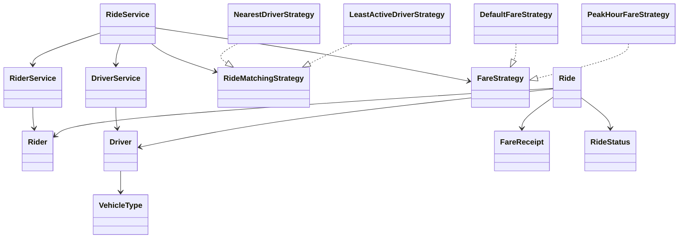

# RideWise Class Model

**Author:** Vishal Verma  
**Purpose:** Explain key classes and their responsibilities.

## Model
- **`Rider`**: Stores rider ID, name, and location.
- **`Driver`**: Stores driver ID, name, location, vehicle type, availability, and active ride count.
- **`Ride`**: Stores ride ID, rider, optional driver, distance, status, and optional fare receipt; enforces lifecycle rules.
- **`FareReceipt`**: Stores ride ID, fare amount, and generation timestamp.
- **`RideStatus`**: `REQUESTED`, `ASSIGNED`, `COMPLETED`, `CANCELLED`.
- **`VehicleType`**: `BIKE`, `AUTO`, `CAR`.

## Services
- **`RiderService`**: Rider registration, lookup, listing, and validation.
- **`DriverService`**: Driver registration, lookup, listing, availability/location updates.
- **`RideService`**: Coordinates ride requests, matching, assignment, fare calculation, completion, cancellation, and driver allocation updates.

## Strategy interfaces and implementations
- **`RideMatchingStrategy`**: Contract for choosing a driver.
- **`NearestDriverStrategy`**: Chooses the eligible driver with the smallest numeric-location difference.
- **`LeastActiveDriverStrategy`**: Chooses the eligible driver with the smallest active ride count.
- **`FareStrategy`**: Contract for fare calculation.
- **`DefaultFareStrategy`**: Calculates fare using the sample default rate.
- **`PeakHourFareStrategy`**: Calculates fare using the sample peak rate.

## Exceptions and utility
- **`RideWiseException`**: Base class for expected domain errors.
- Specialized exceptions represent invalid input, missing entities, duplicate registration, no available driver, and invalid ride states.
- **`IdGenerator`**: Generates UUIDs.

## Class diagram

## Design notes
Keep domain rules in models/services, algorithms in strategy implementations, and console input/output in `Main`. Validate constructor dependencies and inputs early. Confirm the final source matches this document.
