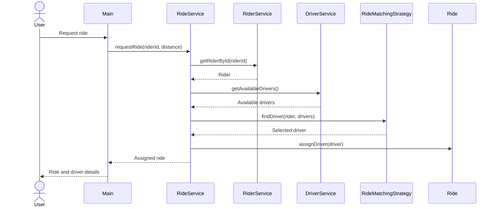
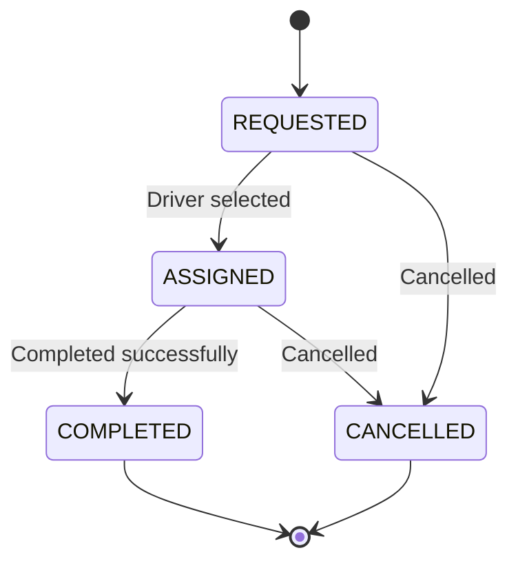

# RideWise Object Relationships

**Author:** Vishal Verma  
**Purpose:** Describe collaboration between objects during ride workflows.

## Relationship summary

| Source | Relationship | Target | Meaning |
|---|---|---|---|
| `RiderService` | manages | `Rider` | Registers and retrieves riders. |
| `DriverService` | manages | `Driver` | Registers and retrieves drivers. |
| `RideService` | depends on | `RiderService` | Looks up the requesting rider. |
| `RideService` | depends on | `DriverService` | Retrieves eligible drivers and updates driver allocation. |
| `RideService` | uses | `RideMatchingStrategy` | Delegates driver selection. |
| `RideService` | uses | `FareStrategy` | Delegates fare calculation. |
| `Ride` | references | `Rider` | Every ride belongs to one rider. |
| `Ride` | optionally references | `Driver` | Assigned after successful matching. |
| `Ride` | optionally references | `FareReceipt` | Created when completion succeeds. |

## Ride request sequence

## Ride lifecycle

## State consistency
- Do not release a driver if no driver was assigned.
- Do not increment active rides before assignment succeeds.
- Validate a receipt's ride ID before changing status to completed.
- If fare calculation fails, the ride should remain assigned.
- Failed operations should leave ride status and driver state unchanged.

If the current implementation throws before storing a ride when no driver is available, document that failed request as not retained in ride history.
